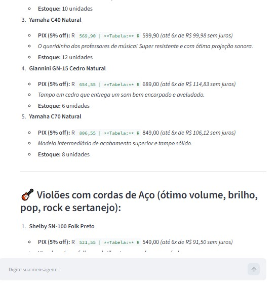
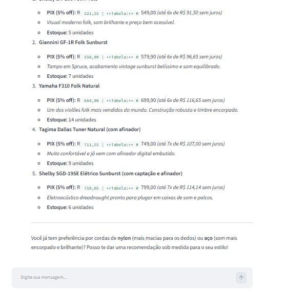

# 🎸 Empório da Música — Intelligent Customer Support Agent

> Text-based conversational agent prototype engineered as a solution for the **Artefact AI Engineer** Technical Challenge.

This project automates the customer support operations for **Empório da Música**, a traditional musical instrument retailer based in Campo Grande/MS, Brazil. The agent operates in a hybrid fashion: resolving inquiries regarding the operational catalog (prices, real-time inventory, customer orders, and promotions) by querying deterministic relational data, while interpreting institutional policies (exchanges, CDC consumer law, warranties, shipping, and business hours) directly from the store's internal policy manual.

---

## 🏗️ System Architecture & Decision Flow

The agent adopts a modular design powered by **Native Tool Calling (Function Calling)**, ensuring that the model deterministically selects whether to query structured relational databases or unstructured text retrieval without bleeding responsibilities:

```text
[ User / Customer ]
        │
        ▼
[ Interface: CLI (main.py) or Streamlit (app.py) ]
        │
        ▼
[ Agent Core: Gemini LLM + Session Memory (agent.py) ]
        │
        ├──► 1. Catalog / Price / Stock / Order Inquiries
        │       └──► Tool: SQLite In-Memory Engine (database.py)
        │            (Calculates prices, validates active promotions, checks inventory)
        │
        ├──► 2. Institutional / Rules / Warranty / Exchange Inquiries
        │       └──► Tool: Lexical/Semantic RAG (rag_engine.py)
        │            (Topical segmentation and search on Policy Manual PDF)
        │
        └──► 3. Greetings or Out-of-Scope Requests (Accessories)
                └──► Direct Guardrail Response via System Prompt (prompts.py)
🛠️ Justification of Technical Decisions
1. LLM Provider and Model
Choice: Google Gemini (gemini-2.0-flash / gemini-3.8-flash)
Technical Justification:
Function Calling Reliability: Models from Google's Flash family provide native, first-class support for tool execution with ultra-low latency and near-zero argument hallucination rates.
Cost-Efficiency: Negligible inference cost (or zero-cost tier via Google AI Studio), paired with an extensive context window.
Reproducibility: Enables technical evaluators to clone and run the project immediately via an API key, without requiring local GPU infrastructure.
2. Framework Approach (Framework-less vs. LangChain)
Choice: Official Native SDK with Tool Calling + Modular Architecture
Technical Justification:
Heavy frameworks like traditional LangChain often introduce excessive abstraction layers (leaky abstractions), complicate runtime debugging, and cause dependency bloat.
Building a decoupled architecture across clean modules (database.py, rag_engine.py, tools.py) demonstrates solid mastery over GenAI fundamentals: message lifecycle management, strict tool contracts, and context isolation.
3. Structured vs. Unstructured Data Handling
Tabular Operational Data (*.csv): In-Memory SQLite (:memory:)
Why not inject raw CSVs into prompt context or vector RAG? Passing raw CSV text into prompts causes severe arithmetic hallucinations, invalid calculations, and broken logical filters (e.g., price <= R$ 1,000 or stock > 0). SQLite guarantees exact mathematical precision and deterministic relational JOIN operations across customers, orders, and products.
Store Policy Manual (políticas_da_loja.pdf): Topical Section RAG
The 8-page internal document was segmented by normative sections (Business Hours, Payment, Returns, Delivery). The retriever injects only the targeted regulatory clauses relevant to each query, eliminating context clutter.
4. Prompt Engineering & Persona
Persona: A warm, informal yet professional attendant ("like a music-savvy friend who understands instruments"), directly aligned with WhatsApp customer service guidelines.
Strict Guardrails:
Negative Catalog Constraint: The store does not retail accessories (picks, loose strings, cables, pedals, cases, amplifiers). Purchase attempts are politely declined with suggestions of partner stores.
Truthfulness / Zero-Hallucination: The agent is strictly instructed never to confirm inventory, prices, or delivery dates without executing the appropriate database tools.
5. Conversational Memory & Temporal Simulation (Time Drift)
Memory Buffer: Stateful continuous session via Gemini's native chat session, ensuring accurate anaphora resolution (e.g., customer asks "How much is the Takamine GD20?" and follows up with "Can you split it in installments?").
Reference Date (REFERENCE_DATE=2026-03-23): To preserve chronological consistency with dataset orders (recorded between late 2025 and March 2026), the system accepts a simulated reference date that anchors delivery timelines and return eligibility.
📋 Implemented Business Rules
PIX Discount & Non-Cumulativity Rule:
Upfront PIX payments grant a 5% discount over the catalog list price.
By internal policy, this discount is STRICTLY NON-CUMULATIVE with items already under active promotion in promotions.csv.
Expired Promotions Handling:
The agent dynamically inspects the is_active flag. If a promotion is inactive (is_active = 0), the assistant transparently clarifies that the campaign has ended and quotes the standard price.
Inventory Control & Special Lifecycle States:
Out of Stock (stock_quantity = 0): Alerts the user of temporary unavailability and proactively recommends available in-stock alternatives (e.g., Giannini GF-3D).
Discontinued (status = 'discontinued'): Informs that the instrument was retired from production and suggests equivalent successors (e.g., Shelby SN-7C).
Coming Soon (status = 'coming_soon'): Informs that the item is an upcoming product release (e.g., Kala Barítono Cedar).
CDC Consumer Law Compliance & Sanitary Exceptions:
Online purchases qualify for a 7-day unconditional right of withdrawal (return shipping paid entirely by the store).
30-day coverage for manufacturing defects handled directly by the store.
Sanitary Exception: Wind instrument mouthpieces (boquilhas) are strictly ineligible for return/exchange due to hygiene regulations.
Regional Delivery Policies (Campo Grande & Interior):
Greater Campo Grande: Free delivery for orders above R
500.00
;
f
i
x
e
d
f
e
e
o
f
R
500.00;fixedfeeofR
 35.00 below that threshold (1 to 3 business days via motoboy).
🚀 How to Run the Project
Prerequisites
Python 3.10 or higher installed.
Google Gemini API Key (Google AI Studio).
1. Clone and Access the Repository
code
Bash
git clone https://github.com/PriCas/DesafioArtefactAgenteAtendimentoEmporioMusica.git
cd DesafioArtefactAgenteAtendimentoEmporioMusica
2. Configure the Virtual Environment
On Windows (PowerShell):
code
Powershell
python -m venv venv
.\venv\Scripts\Activate.ps1
(If execution is blocked on PowerShell, run: Set-ExecutionPolicy -Scope Process -ExecutionPolicy Bypass)
On Linux / macOS or Git Bash:
code
Bash
python -m venv venv
source venv/Scripts/activate  # or source venv/bin/activate on Linux/Mac
3. Install Dependencies
code
Bash
pip install -r requirements.txt
4. Configure Environment Variables
Create a .env file in the root directory (or copy from .env.example):
code
Env
# Google Gemini API Key (Required)
GEMINI_API_KEY=your_api_key_here

# Recommended Gemini Model
GEMINI_MODEL=gemini-2.0-flash

# Simulated reference date for coherence with dataset order timestamps
REFERENCE_DATE=2026-03-23
5. Run the Application
Option A: Interactive Terminal CLI (Rich styled terminal):
code
Bash
python main.py
Option B: Full-Stack Web Interface (Streamlit):
code
Bash
streamlit run app.py
💬 Documented Interaction Examples
The repository includes detailed conversation logs covering trivial and edge-case scenarios in:
📁 examples/conversas_exemplo.md
Scenario 1: Structured catalog query with price and category constraints ("What guitar options are available up to R$ 1,000?").
Scenario 2: Institutional inquiries, physical store location, and operating hours.
Scenario 3: Price inquiry with expired promotional campaign and non-cumulative PIX calculation (Takamine GD20).
Scenario 4: Applying Consumer Protection Code (CDC) rules for online e-commerce returns.
Scenario 5: Negative scope intercept (graceful rejection of guitar picks and strings).
⚖️ Known Limitations & Future Roadmap
With additional production development time, the following improvements would be prioritized:
Two-Factor Authentication (LGPD / Privacy): Currently, order inquiries rely on order_id. In a production environment, dual verification (CPF/phone via SMS OTP) would be required before returning order details.
Advanced Hybrid Search (BM25 + Dense Embeddings): Upgrade the lexical chunking system with a lightweight vector database (e.g., ChromaDB or Qdrant) paired with dense embeddings (all-MiniLM-L6-v2) for complex conceptual queries.
Human-in-the-Loop Escalation: Real-time sentiment analysis to detect frustrated customers and trigger an automated handoff to human agents via Zendesk or WhatsApp API.
Automated Regression Testing (Eval Framework): Implementing test suites with pytest and fidelity metrics (RAG Triad) to guarantee system prompt changes never break business constraints.
🤖 AI Code Assistants Workflow
In full compliance with Artefact's evaluation guidelines, AI code assistants (Gemini 3.8-flash and Claude) were utilized across the following engineering workflows:
Architecture & Scaffolding: Initial schema mapping of the in-memory SQLite tables and typing decorators for tool definitions.
Prompt Engineering: Iterative refinement of system instructions to reinforce negative-catalog guardrails (strictly refusing accessory sales).
📸 Interaction Evidence & Test Logs
Below are the actual interaction screenshots demonstrating the agent handling operational queries and domain guardrails in real time:
<p align="center">

</p>
<p align="center">

</p>
<p align="center">

</p>
<p align="center">

</p>
<p align="center">

</p>
<p align="center">

</p>
<p align="center">

</p>
Crafted with engineering rigor, Python, and plenty of coffee. Developed for the Artefact Technical Challenge.
code
Code
---

### Como salvar e atualizar no seu GitHub agora:

1. No seu VS Code, abra o arquivo **`README.md`**.
2. Selecione tudo (`Ctrl + A`), apague e cole o texto acima.
3. Salve com **`Ctrl + S`**.
4. No terminal, envie a versão final para o GitHub:
   ```powershell
   git add README.md
   git commit -m "docs: finalize full english documentation with complete image gallery and technical decisions"
   git push origin main