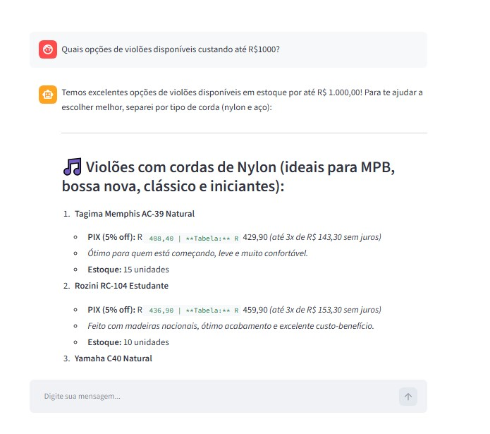
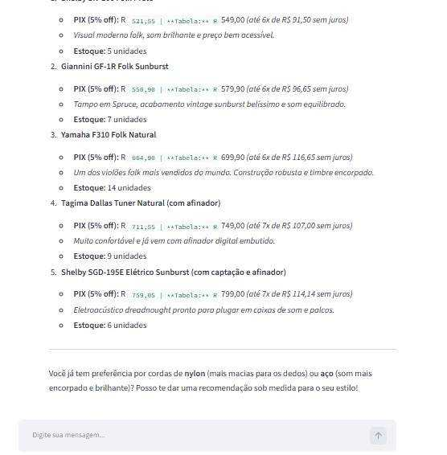
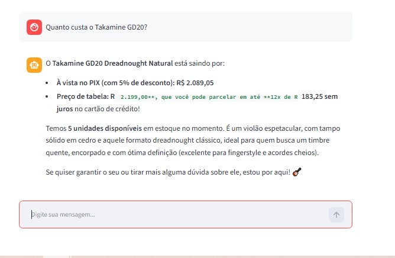
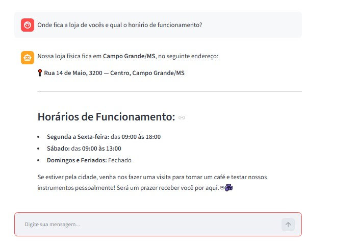
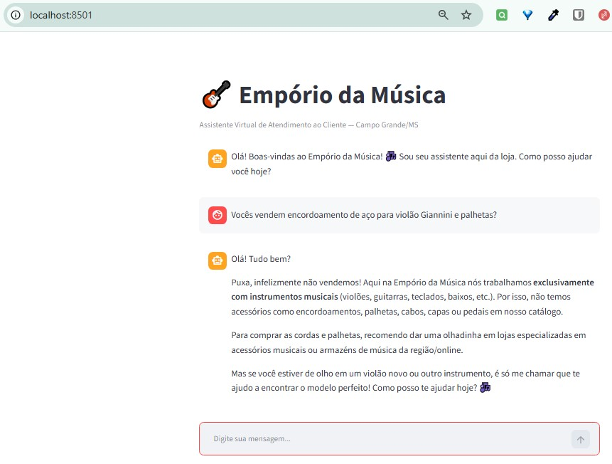
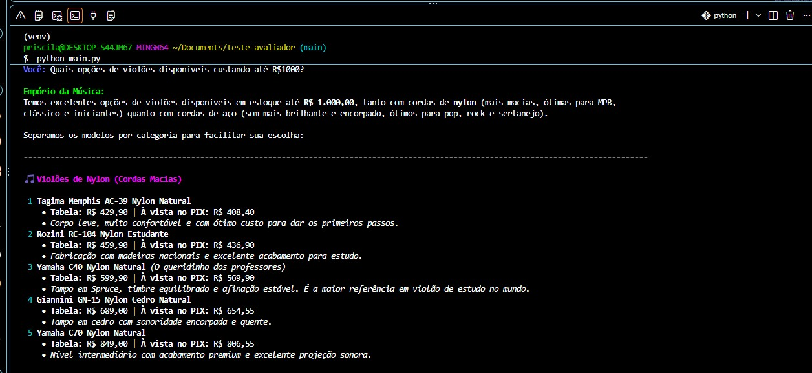
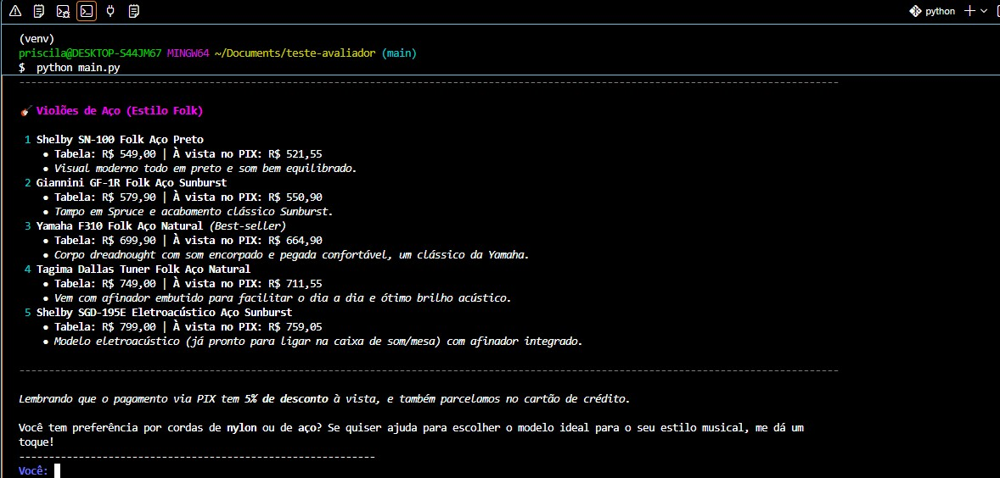

# 🎸 Empório da Música — Intelligent Customer Support Agent

> Text-based conversational agent prototype engineered for the **Artefact AI Engineer** Technical Challenge.

This project automates customer support for **Empório da Música**, a traditional musical instrument retailer in Campo Grande/MS. The agent operates in a hybrid fashion: resolving operational queries (catalog, prices, real-time inventory, orders, and promotions) via deterministic relational queries (in-memory SQLite), while retrieving institutional policies (CDC consumer laws, returns, warranties, and business hours) directly from the store manual.

---

## 🏛️ System Architecture & Decision Flow

The solution follows a clean, modular design powered by **Native Function Calling**:

```text
[Customer Message] ➔ [CLI / Streamlit UI] ➔ [Gemini Agent Core + Memory]
                                                   │
        ┌──────────────────────────────────────────┼──────────────────────────────────────────┐
        ▼                                          ▼                                          ▼
 [Catalog & Promos]                         [Order Tracking]                           [Store Policies]
 SQLite In-Memory Database                  Relational SQL Joins                       Topical PDF Retrieval
 • Real-time stock availability             • Order delivery status                    • CDC 7-day return rules
 • Accurate pricing & active discounts      • Carrier tracking codes                   • Warranty & business hours
 • Strict PIX 5% rule (non-cumulative)      • Items and customer match                 • Sanitary exceptions (mouthpieces)
```
## 🛠️ Justification of Technical Decisions

Layer / Decision	Technology Choice	Technical Rationale
LLM Provider	Google Gemini (2.0/3.8 Flash)	Minimal latency, robust native function calling, low inference cost, and reproducible evaluation via API key.
Agent Framework	Modular Native Tools	Avoids heavy LangChain overhead; ensures full payload visibility and deterministic execution.
Structured Data	In-Memory SQLite (:memory:)	Eliminates arithmetic hallucinations and broken price range filters typical of passing raw CSVs to prompts.
Unstructured RAG	Topical Section Retrieval	Extracts exact regulatory clauses (returns, warranties) from the 8-page PDF without context pollution.
Temporal Anchor	REFERENCE_DATE=2026-03-23	Prevents time-drift errors when evaluating 7-day return eligibility against dataset orders from 2025/2026.

## 📋 Implemented Business Rules & Guardrails
Strict Negative Scope (Instruments Only): The store exclusively retails complete musical instruments. Inquiries regarding accessories (strings, picks, cables, pedals, amps) are politely rejected and redirected.
PIX & Active Promotions (5% Upfront): Standard items receive 5% off via PIX. Store policy strictly forbids compounding PIX with active promotion discounts. Inactive promotions (is_active=0) are transparently declared expired.
Inventory States: stock_quantity=0 triggers out-of-stock notices and proactive alternatives; status='discontinued' informs model retirement.
Consumer Protection (CDC): 7-day unconditional withdrawal for online purchases (freight paid by store). Sanitary exception: wind instrument mouthpieces (boquilhas) are strictly non-returnable.
Regional Shipping (Campo Grande): Free delivery for orders above R
500.00;fixedfeeofR 500.00;fixedfeeofR
 35.00 below that threshold (1–3 business days delivery via motoboy).

## 🚀 How to Run the Project
Prerequisites
Python 3.10 or higher
Google Gemini API Key (Google AI Studio)

1. Clone Repository & Setup Virtual Environment
code
Bash
git clone https://github.com/PriCas/DesafioArtefactAgenteAtendimentoEmporioMusica.git
cd DesafioArtefactAgenteAtendimentoEmporioMusica

# Create and activate virtual environment
python -m venv venv
.\venv\Scripts\Activate.ps1   # On Windows PowerShell
  source venv/bin/activate    # On Linux / macOS / Git Bash

# 2. Install Dependencies
code
Bash
pip install -r requirements.txt

# 3. Configure Environment Variables
Create a .env file in the project root:
code
Env
GEMINI_API_KEY=your_gemini_api_key_here
GEMINI_MODEL=gemini-2.0-flash
REFERENCE_DATE=2026-03-23

# 4. Run the Application
Interactive Terminal CLI (Rich formatting):
code
Bash
python main.py
Full-Stack Web Interface (Streamlit):
code
Bash
streamlit run app.py

## 💬 Documented Interaction Examples
Detailed logs are available in: examples/conversas_exemplo.md
Scenario 1: Structured catalog query with price and category constraints ("Guitars available up to R$ 1,000").
Scenario 2: Institutional inquiries, physical store location, and operating hours.
Scenario 3: Price inquiry with expired promotional campaign and non-cumulative PIX calculation (Takamine GD20).
Scenario 4: Applying Consumer Protection Code (CDC) rules for online e-commerce returns.
Scenario 5: Negative scope intercept (graceful rejection of guitar picks and strings).

## 📸 Verified Interaction Evidence (Screenshots)
Below are the actual screenshots demonstrating the agent handling operational queries and domain guardrails in real time:
Scenario 1: Catalog Filtering (Guitars up to R$ 1,000)



Scenario 2: Store Information & Operating Hours

Scenario 3: Real-Time Pricing & Expired Promotion Check (Takamine GD20)

Scenario 4: E-Commerce Return & Freight Policy (CDC 7 Days)

Scenario 5: Negative Scope Guardrail (Accessory Refusal)

Additional Edge Cases & Live Demonstrations



## ⚖️ Known Limitations & Production Roadmap
LGPD 2FA Authentication: Enforce customer verification (SMS OTP or CPF validation) before exposing tracking details.
Hybrid Vector Search: Connect a vector database (ChromaDB/Qdrant) with dense embeddings (all-MiniLM-L6-v2) for complex conceptual queries.
Automated Human Escalation: Implement sentiment analysis to trigger human agent handoff via Zendesk/WhatsApp API.
Evaluation Framework: Implement regression testing using pytest and RAGAS metrics.

## 🤖 AI Code Assistants Workflow
In compliance with Artefact's guidelines, AI code assistants (Gemini 3.8-flash and Claude) were utilized for:
Scaffolding & SQL: Drafting in-memory SQLite schema definitions and typing decorators for tool functions.
Adversarial Prompting: Iterative stress-testing of negative catalog guardrails against accessory purchases.